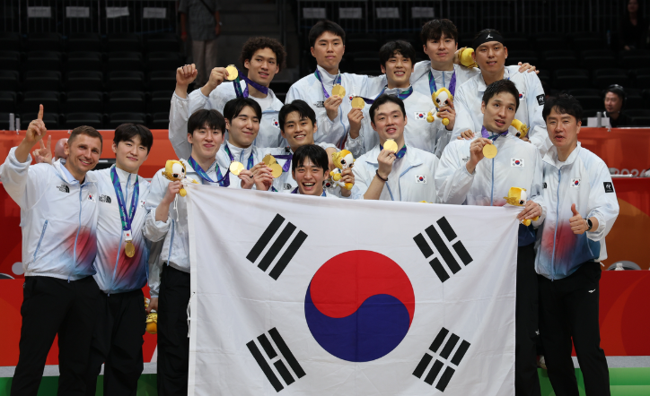

# 🏀 FINELA SPORTS AGENCY - Official Website

> **"PLAY WITH THE MEDALISTS"**  
> 우리는 선수의 한계를 넘어, 새로운 브랜드 가치를 창출합니다.  
> KBL · 해외 리그 · 국가대표 엘리트 선수를 위한 프리미엄 통합 솔루션



---

## 📌 프로젝트 소개 (Overview)

**FINELA SPORTS AGENCY** 공식 웹사이트는 2026 아이치-나고야 아시안게임 남자 농구 국가대표 및 엘리트 선수단을 매니지먼트하는 프리미엄 스포츠 에이전시의 반응형 올인원 웹사이트입니다.

매트 블랙(`#060709`)과 시그니처 네온 레드(`#E60012`) 글래스모피즘, 전술 코트 라인 그래픽을 결합한 다이내믹 UI/UX로 제작되었습니다.

---

## ✨ 핵심 기능 (Features)

1. **메인 히어로 (Hero Section)**
   - 대한민국 농구 국가대표팀의 감동적인 승리/세레머니 5장 사진 순환 슬라이드쇼
   - 붉은 불꽃 & 스타디움 라이트 더스트 앰비언트 캔버스 파티클
   - 주요 계약 규모($18.5M+) 및 메달리스트(8★) 핵심 지표 바
2. **선수단 (Our Athletes - Roster)**
   - 2026 아시안게임 12인 선수단 그리드 & 포지션별(GUARD, FORWARD, CENTER) 필터링
   - 선수 카드 클릭 시 **대형 등번호 워터마크, 4대 스탯, 하이라이트 영상, TV CF, 인스타그램 피드**가 포함된 상세 모달 노출 (좌우 넘김 기능 내장)
3. **토탈 서비스 (Total Management Services)**
   - 3대 탭 인터랙션: 퍼포먼스 트레이닝(최첨단 센터 & 3인 코치진), 프리미엄 숙소(1인 1실, 맞춤 식단, 수중 테라피, 크라이오테라피), 1:1 라이프스타일 & 법률 자문단
4. **공식 스토어 (FINELA Store)**
   - 6종 시그니처 굿즈 및 어센틱 레플리카 져지 카탈로그
   - 상품 퀵뷰 모달(사이즈 선택 가능) 및 실시간 **슬라이딩 장바구니 드로어(Cart Drawer)**
5. **공식 파트너사 (Our Partners)**
   - 나이키, 게토레이, 삼성, SK텔레콤 등 8대 글로벌 후원사 (호버 시 브랜드 시그니처 컬러 변환)
6. **문의하기 (Contact Us)**
   - 본사 주소/연락처 및 브랜드 파트너십/선수 입단 문의 폼 (유효성 검사 및 전송 피드백 알림)

---

## 🚀 깃허브(GitHub) 업로드 및 버셀(Vercel) 배포 가이드

### 1단계: 깃허브(GitHub)에 업로드하기

1. [GitHub.com](https://github.com)에 로그인 후, 우측 상단의 **[+] 버튼 ➔ [New repository]**를 클릭합니다.
2. Repository name에 `finela-sports-agency`를 입력하고 **[Create repository]**를 누릅니다.
3. 내 컴퓨터의 터미널(PowerShell 또는 Git Bash)에서 현재 프로젝트 폴더로 이동한 뒤, 아래 명령어를 차례대로 입력합니다:

```bash
# 1. 깃 초기화 및 파일 추가
git init
git add .
git commit -m "feat: Initial commit for FINELA SPORTS AGENCY website"

# 2. 브랜치명을 main으로 설정
git branch -M main

# 3. 내 깃허브 주소와 연결 (본인의 깃허브 아이디로 변경하세요)
git remote add origin https://github.com/YOUR_GITHUB_USERNAME/finela-sports-agency.git

# 4. 깃허브로 업로드
git push -u origin main
```

---

### 2단계: 버셀(Vercel)에 1분 만에 배포하기

1. [Vercel.com](https://vercel.com)에 접속하여 **GitHub 계정으로 로그인**합니다.
2. 대시보드에서 **[Add New...] ➔ [Project]**를 클릭합니다.
3. 방금 올린 `finela-sports-agency` 저장소를 찾아 **[Import]**를 클릭합니다.
4. Framework Preset은 `Other`로 두고, 아무 설정도 변경할 필요 없이 **[Deploy]** 버튼을 클릭합니다.
5. 약 30초 후 배포가 완료되며, 전 세계 어디서나 접속할 수 있는 **무료 도메인(`https://finela-sports-agency.vercel.app`)**이 즉시 생성됩니다! 🎉

---

## 🛠️ 콘텐츠 수정 방법 (Maintenance Guide)

웹사이트의 모든 텍스트, 선수 명단, 스탯, 상품 가격, 이미지 경로는 **`finela-data.js`** 파일 하나에서 손쉽게 수정할 수 있습니다.

- **선수 정보 변경/추가**: `finela-data.js`의 `PLAYERS_DATA` 배열 수정
- **스토어 굿즈 변경**: `finela-data.js`의 `PRODUCTS_DATA` 배열 수정
- **서비스 및 파트너사 변경**: `finela-data.js`의 `SERVICES_DATA`, `SPONSORS_DATA` 수정

수정 후 `git commit -am "update: 선수 정보 수정"` 및 `git push`를 실행하면 **버셀이 자동으로 감지하여 10초 만에 사이트를 실시간 업데이트**합니다.

---

## 📂 파일 구조 (Project Structure)

```text
FINELA 에이전트/
├── index.html              # 메인 공식 웹사이트 단일 페이지
├── styles.css              # 다크 모드 & 네온 레드 반응형 스타일시트
├── main.js                 # 모달, 슬라이드쇼, 장바구니 등 인터랙티브 로직
├── finela-data.js          # 선수, 상품, 서비스, 파트너사 통합 설정 데이터
├── vercel.json             # Vercel 배포 및 캐싱 헤더 설정 파일
├── package.json            # 프로젝트 메타데이터
├── .gitignore              # 불필요한 시스템 파일 제외 설정
├── README.md               # 프로젝트 안내 및 배포 매뉴얼
└── assets/                 # 최적화된 로컬 이미지 에셋
    ├── hero/               # 메인 5장 순환 국대 세레머니 사진
    ├── players/            # 선수단 12인 실사 및 카드
    ├── detail/             # 선수 상세 액션 컷 및 영상 썸네일
    ├── media/              # TV CF 및 인스타그램 포스트 피드
    ├── services/           # 최첨단 시설 및 부대시설 사진
    └── store/              # 공식 굿즈 상품 실사
```

---

## 📄 License
본 프로젝트는 포트폴리오 및 비상업적 목적으로 기획·제작되었습니다.  
© 2026 FINELA SPORTS AGENCY. All Rights Reserved.
